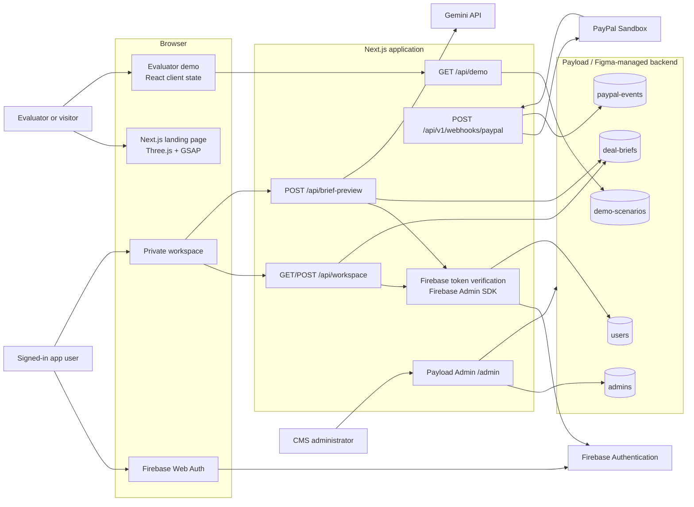
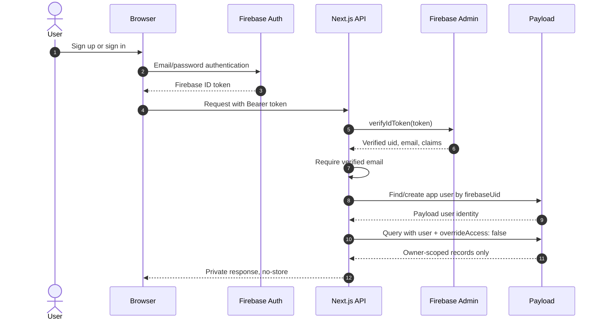
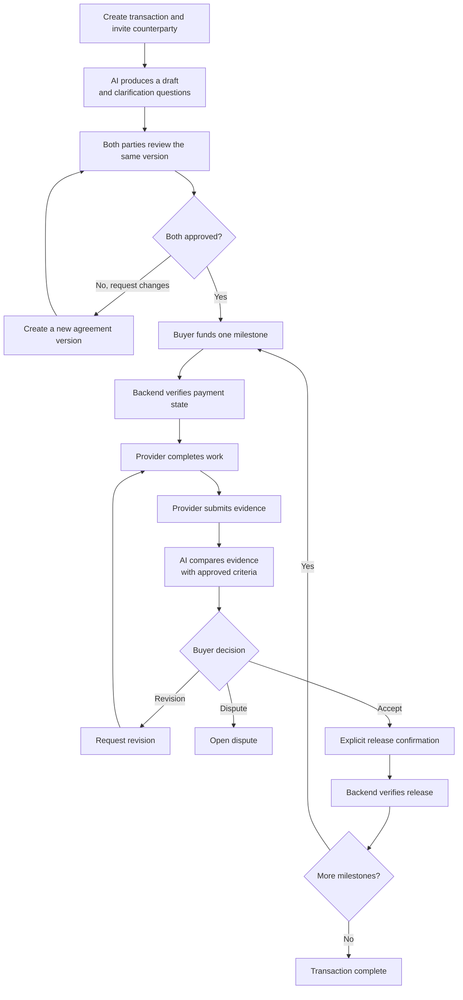
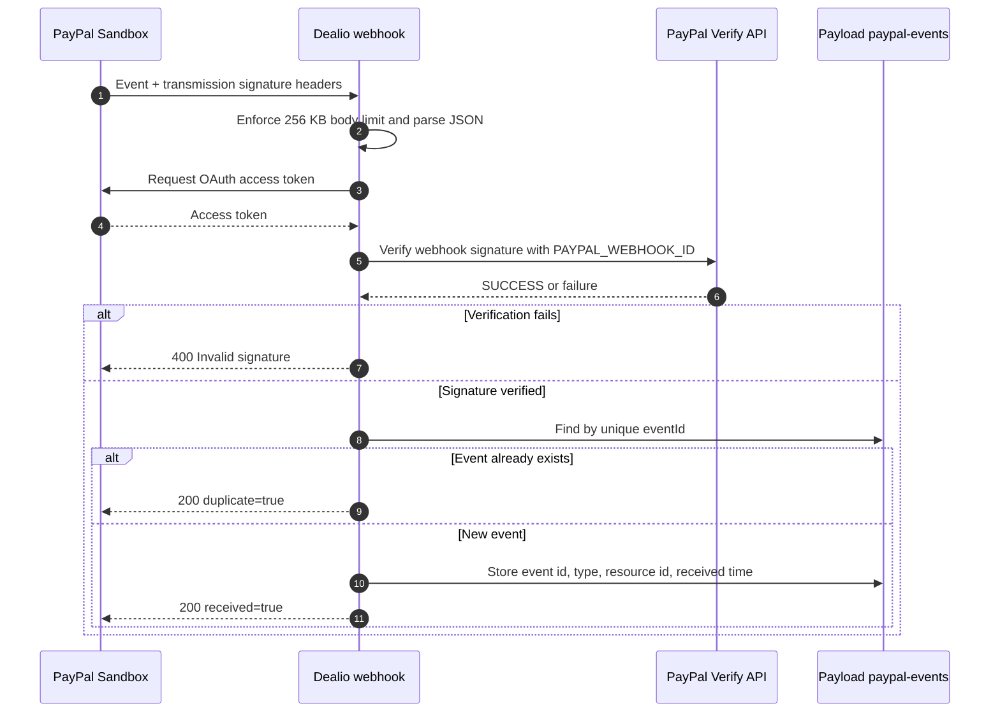

# Dealio

<div align="center">

**Clear terms. Verified delivery. Human payment decisions.**

Dealio is a two-party transaction assurance experience for freelance and digital-service work. It connects a structured agreement, milestone funding, delivery evidence, AI-assisted verification, and an explicit buyer decision in one traceable workflow.

[Explore the evaluator demo](https://dealio.vercel.app/explore) · [Open the app](https://dealio.vercel.app) · [Report an issue](https://github.com/vengeance0112/Dealio/issues)

</div>

> [!IMPORTANT]
> Dealio is currently an evaluator-ready product demo with real Firebase authentication, private Payload-backed briefs, server-side Gemini draft previews, and a verified PayPal Sandbox webhook inbox. The interactive deal, evidence, payment, release, dispute, agent, and operations flows under `/explore` are explicitly simulated. Dealio is not a licensed escrow service and does not currently execute real PayPal orders, captures, payouts, refunds, or releases.

---

## Why Dealio?

Informal service deals usually split the important facts across conversations, documents, file links, and payment screens:

- Providers complete work and then chase payment.
- Buyers cannot objectively tell whether a milestone meets the original agreement.
- Scope, revisions, deadlines, and completion criteria remain ambiguous.
- When a disagreement happens, neither side has one reliable timeline.

Dealio brings those pieces together:

1. **Agree** — turn a brief into milestones, deliverables, and acceptance criteria.
2. **Fund** — fund one milestone at a time through a PayPal-style workflow.
3. **Deliver** — submit work with notes, files, and supporting links.
4. **Verify** — compare evidence against every approved criterion.
5. **Decide** — a human accepts, requests a revision, or opens a dispute.
6. **Record** — keep agreement, delivery, verification, payment, and dispute events in one timeline.

AI can structure and explain the information. It cannot approve an agreement, accept delivery, or move money.

## Product tour

The evaluator experience requires no account:

```text
Open / → Explore the product → Switch between Priya and Daniel → Follow the action cards
```

### Demo personas

| Perspective | Persona | What to explore |
|---|---|---|
| Provider | Priya Raman, Raman Design Studio | Agreement editing, starting work, delivery submission, revision |
| Buyer | Daniel Whitfield, Whitfield & Co. Hospitality | Agreement approval, simulated funding, verification, release decision |
| Operations | Fictional Dealio operations view | Webhook events, disputes, transaction activity, audit trail |

### Recommended evaluator path

1. Open **Brand Website Redesign**.
2. Review the active agreement and its milestone criteria.
3. As **Priya**, submit the *Discovery and UI Design* milestone.
4. Switch to **Daniel** and run the verifier.
5. Observe the first report flagging the missing mobile layout.
6. Request a revision, switch back to Priya, and resubmit.
7. Review the passing report and explicit release confirmation.
8. Open **Seasonal Menu Photography** to inspect a disputed transaction.
9. Visit **Agent** to see read-only status answers and proposed-action cards.

Demo changes live only in browser memory and reset on reload. Demo uploads retain filenames only; file contents are not uploaded.

## Feature matrix

| Capability | Evaluator demo | Signed-in workspace | Production status |
|---|:---:|:---:|---|
| Responsive landing page, 3D scene, GSAP interaction | Yes | N/A | Delivered |
| Provider, buyer, and operations perspectives | Yes | No | Simulated |
| Transaction dashboard and status-driven actions | Yes | No | Simulated |
| Agreement generation, versioning, and approval | Yes | Gemini preview only | Simulated / partial |
| Milestones and criterion checklists | Yes | No | Simulated |
| Delivery submission and revision loop | Yes | No | Simulated |
| Criterion-by-criterion verification report | Yes | No | Deterministic demo only |
| PayPal funding and release UI | Yes | No | Simulated only |
| Verified PayPal webhook ingestion | No | Server-side | Delivered |
| Webhook event deduplication | No | Server-side | Delivered |
| Dispute flow and neutral summary | Yes | No | Simulated |
| Messages, notifications, and proposing agent | Yes | No | Simulated |
| Firebase email/password authentication | N/A | Yes | Delivered |
| Email verification and password reset | N/A | Yes | Delivered |
| Private, owner-scoped deal briefs | N/A | Yes | Delivered |
| Gemini structured draft preview | N/A | Yes | Delivered when configured |
| Private evidence storage and signed downloads | No | No | Not implemented |
| Real PayPal order, capture, payout, refund, reconciliation | No | No | Not implemented |

## Architecture

### System architecture



### Authentication and ownership flow



Payload Admin authentication and public app authentication are intentionally separate. Public app users cannot use the `/admin` CMS session.

### Agreement-to-release product flow



The evaluator demo implements this flow interactively with fictional data. The signed-in workspace currently implements private briefs and Gemini draft previews, not the full durable state machine.

### Verified PayPal webhook flow



The webhook is an authenticated, idempotent event inbox. It does **not** update payment or milestone state yet.

## Technology stack

| Layer | Technology |
|---|---|
| Framework | Next.js 16 App Router, React 19, TypeScript 6 |
| Styling | Tailwind CSS 4 |
| 3D and motion | Three.js, GSAP, ScrollTrigger |
| Durable data / CMS | Payload 4 with `@payloadcms/figma` |
| App authentication | Firebase Authentication + Firebase Admin token verification |
| AI | Gemini `gemini-2.5-flash`, server-side structured JSON |
| Payments | PayPal Sandbox webhook verification |
| Validation | Zod plus Payload field validation |
| Icons | Lucide React |
| Package manager | pnpm |

## Repository structure

```text
.
├── src
│   ├── app
│   │   ├── (frontend)
│   │   │   ├── api
│   │   │   │   ├── brief-preview/       # Authenticated Gemini draft preview
│   │   │   │   ├── demo/                # Public evaluator scenario
│   │   │   │   ├── v1/webhooks/paypal/  # Verified PayPal event inbox
│   │   │   │   └── workspace/           # Private brief API
│   │   │   ├── explore/                  # Evaluator experience
│   │   │   ├── login|signup|workspace/   # App auth and private workspace
│   │   │   └── page.tsx                  # Public landing page
│   │   └── (payload)/                    # Framework-managed Payload routes
│   ├── collections
│   │   └── Dealio.ts                     # Users, briefs, demo, PayPal events
│   ├── components
│   │   ├── landing/                      # Three.js + GSAP landing experience
│   │   ├── Account.tsx                   # Firebase UI and private workspace
│   │   └── Explore.tsx                   # Demo bootstrap
│   ├── demo                              # Complete fictional product workflow
│   ├── lib
│   │   ├── firebase-client.ts
│   │   └── firebase-server.ts
│   └── payload.config.ts
├── tests
│   └── demo-workflow.cjs
├── public
│   └── dealio-source.zip
├── next.config.ts
└── package.json
```

## Routes and APIs

### Public pages

| Route | Purpose | Rendering |
|---|---|---|
| `/` | Interactive landing page | Static |
| `/explore` | No-login evaluator demo shell | Static + request-time demo API |
| `/login` | Firebase login | Static client shell |
| `/signup` | Firebase registration | Static client shell |
| `/forgot-password` | Firebase password reset | Static client shell |
| `/workspace` | Private brief workspace | Static client shell + authenticated API |
| `/privacy` | Privacy and demo disclosure | Static |
| `/admin` | Payload CMS admin | Dynamic, separate admin auth |

### Application endpoints

| Method | Endpoint | Access | Purpose |
|---|---|---|---|
| `GET` | `/api/demo` | Public | Reads the fictional evaluator scenario |
| `GET` | `/api/workspace` | Firebase bearer token | Lists the caller's private briefs |
| `POST` | `/api/workspace` | Firebase bearer token | Creates a validated private brief |
| `POST` | `/api/brief-preview` | Firebase bearer token | Generates a validated Gemini draft preview |
| `POST` | `/api/v1/webhooks/paypal` | Verified PayPal signature | Deduplicates and stores Sandbox events |

## Local development

### Prerequisites

- Node.js `>=24.22.1`
- pnpm 9, 10, or 11
- A connected Figma Make Payload backend for the managed database/runtime
- Firebase project access if you need to test real app accounts
- Gemini and PayPal Sandbox credentials for those integrations

### Install and run

```bash
pnpm install
pnpm dev
```

The server listens on `PORT` and defaults to `3000`:

```bash
PORT=3000 pnpm dev
```

In Figma Make, the development server is started and supervised automatically; do not start a second server there.

### Quality checks

```bash
# Type safety
pnpm exec tsc --noEmit

# Deterministic demo verifier scenarios
node tests/demo-workflow.cjs

# Production build
pnpm build

# Figma-managed production validation
figma make verify-deploy
```

The last verified production route table classified `/`, `/explore`, `/login`, `/signup`, `/forgot-password`, `/workspace`, and `/privacy` as static pages. API and Payload routes are request-time dynamic.

## Configuration

### Firebase

The Firebase web configuration in `src/lib/firebase-client.ts` is intentionally public, as Firebase client configuration is not a secret. Security depends on Firebase Authentication, verified server-side ID tokens, authorized domains, Payload access control, and Firebase project rules.

In Firebase Console:

1. Open **Authentication → Sign-in method**.
2. Enable **Email/Password**.
3. Add each deployed hostname under **Authentication → Settings → Authorized domains**.
4. Configure password-reset and verification-email templates for your brand.

The server verifies tokens against Firebase project `dealio-effe8` and requires `email_verified`.

### Server-only environment variables

Never commit these values and never expose them with a `NEXT_PUBLIC_` prefix:

| Variable | Required for | Notes |
|---|---|---|
| `APP_GEMINI_API_KEY` | Gemini draft preview | Create and rotate in Google AI Studio / Google Cloud |
| `PAYPAL_CLIENT_ID` | PayPal webhook verification | Sandbox app client ID |
| `PAYPAL_CLIENT_SECRET` | PayPal webhook verification | Sandbox app secret |
| `PAYPAL_WEBHOOK_ID` | PayPal signature verification | ID for the webhook URL deployed with this code |

Configure secrets through Figma Make **Settings → Secrets** or the equivalent encrypted secret manager in the target platform.

Example names only:

```bash
APP_GEMINI_API_KEY=...
PAYPAL_CLIENT_ID=...
PAYPAL_CLIENT_SECRET=...
PAYPAL_WEBHOOK_ID=...
```

No `.env` values belong in commits, issues, screenshots, logs, or client bundles. Rotate any credential that has previously been pasted into chat or another public channel.

## Payload collections and access

| Collection | Purpose | Access model |
|---|---|---|
| `admins` | Payload CMS editors | Existing Figma/Payload admin authentication |
| `users` | Firebase-linked app identities | Own profile read; no public create/update/delete |
| `deal-briefs` | Private user briefs | Owner-scoped reads; server assigns owner; immutable via current API |
| `demo-scenarios` | Fictional evaluator state | Public read; admin-only mutation |
| `paypal-events` | Verified provider event inbox | Admin read; only trusted server code creates; immutable |

User-facing Payload Local API calls pass the authenticated app user and `overrideAccess: false`. Firebase identity synchronization is the only trusted operation that bypasses collection access, because no app-user record exists before first sign-in.

## Security model

- Firebase credentials are never duplicated in Payload.
- App users and Payload administrators are separate identity systems.
- Private APIs require a verified Firebase bearer token.
- Email verification is required before private records can be accessed.
- Owners are assigned server-side and cannot be supplied by the browser.
- Payload row-level access filters private briefs by owner.
- User input is allowlisted and validated with Zod and Payload constraints.
- Private API responses use `Cache-Control: private, no-store`.
- Gemini is called only from the server; model output is schema-validated.
- Gemini receives one brief at a time and is instructed to treat content as untrusted data.
- PayPal webhook bodies are size-limited, signatures are verified with PayPal, and event IDs are unique.
- No payment secret, Gemini key, Firebase ID token, or PayPal access token is rendered to the browser or stored in Payload documents.

## Deployment

### Figma Make

Use the repository's managed lifecycle:

```bash
figma make verify-deploy
```

Publish through Figma Make after verification. Payload database, admin authentication, and storage are supplied by the managed platform integration.

### Vercel or another standalone platform

The repository uses `@payloadcms/figma`, so a plain source import does not automatically reproduce the managed backend. Before deploying to a separate platform, provide a supported Payload database/storage/runtime configuration and confirm that the Figma integration supports that target.

The configured PayPal webhook URL must resolve to the deployment that actually runs this code:

```text
https://<deployed-host>/api/v1/webhooks/paypal
```

For the proposed domain, that would be:

```text
https://dealio.vercel.app/api/v1/webhooks/paypal
```

Do not register that URL until the application is deployed there and returns a controlled response. Use the **Sandbox** PayPal app and Sandbox events only.

## Observability and error behavior

- User-facing APIs return structured JSON errors without stack traces or secrets.
- Workspace errors include a request ID.
- The webhook distinguishes missing configuration, invalid signatures, malformed bodies, duplicates, and retryable processing failures.
- Payload admin provides operational visibility into verified event records.
- A production implementation should add structured logging, error tracking, latency metrics, alerting, scheduled PayPal reconciliation, and documented incident response.

## Production-readiness roadmap

The following are required before Dealio can be described as production-ready for real transactions:

- Durable two-party invitations, membership, and transaction authorization.
- Immutable agreement versions with document hashes and authenticated approvals.
- Private evidence upload collection with MIME/size limits, malware scanning, checksums, and expiring downloads.
- Structured evidence extraction and AI verification against the accepted agreement version.
- PayPal order creation, buyer approval handling, capture verification, and strict state transitions.
- Payout/release orchestration with idempotency, reconciliation, and failure recovery.
- Refund handling and formal PayPal dispute/chargeback guidance.
- Append-only audit logs for every privileged and payment action.
- Rate limits, abuse controls, CSP/security headers, monitoring, backups, retention, and account deletion.
- Automated unit, integration, access-control, webhook, payment sandbox, and end-to-end tests.
- Independent security, privacy, financial-regulatory, and PayPal-partner review.

## Product and legal boundaries

- Dealio is not a marketplace, wallet, payment gateway, legal service, or licensed escrow.
- AI output is advisory and not legal advice.
- AI never approves agreements, accepts delivery, or executes payment operations.
- A document hash can demonstrate integrity but does not by itself create a legally guaranteed signature.
- PayPal Sandbox events and demo statuses do not prove real funds exist.
- Production funded-milestone behavior may require PayPal marketplace/partner approval or a properly licensed arrangement.

## Contributing

1. Create a branch from `main`.
2. Keep changes scoped and add tests for workflow or access-control behavior.
3. Run type checking, the demo workflow test, and the production build.
4. Never add secrets, real customer data, production Firebase tokens, or PayPal payloads to fixtures.
5. Open a pull request explaining behavior, security implications, and verification performed.

## License

No open-source license has been added yet. All rights are reserved by the repository owner unless a license file is added. Add an explicit `LICENSE` before advertising the repository as open source.

---

<div align="center">

**Dealio — agree clearly, work confidently, decide with evidence.**

</div>
